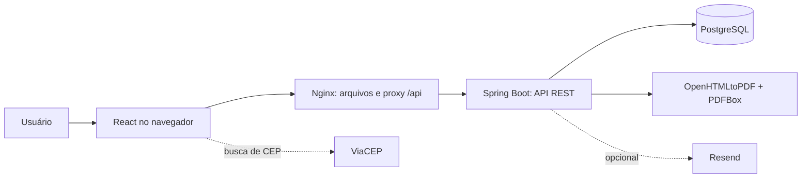
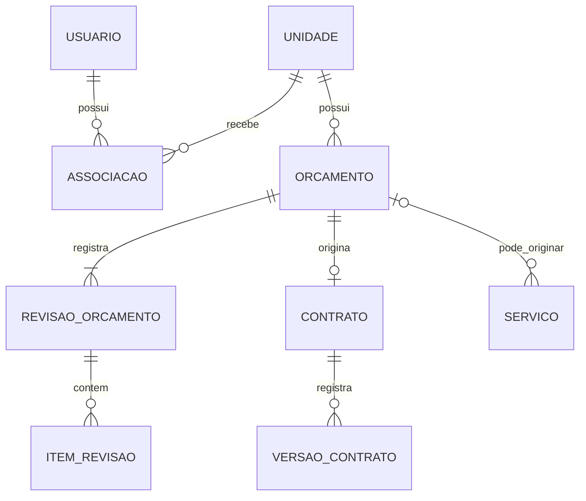

# Arquitetura

## Visão de componentes

São dois repositórios independentes. O Compose na API reúne os três serviços locais: PostgreSQL, API e web. A documentação do domínio e da arquitetura fica neste cofre, versionado junto à API.

## Tecnologia e organização

| Camada | Tecnologia / responsabilidade |
|---|---|
| Interface | React 18, React Router e Vite; componentes e páginas reutilizáveis |
| Editor | Tiptap para conteúdo formatado dos modelos/contratos |
| Gráficos | Recharts para indicadores |
| Backend | Java 21 e Spring Boot 4.1, monólito organizado por domínio |
| HTTP | Controllers REST e DTOs de entrada/saída |
| Regras | Services transacionais, validações e transições |
| Persistência | JPA/Hibernate e repositories; PostgreSQL |
| Migrações | Flyway V1 (estrutura inicial) e V2 (sessões de renovação) |
| PDF | OpenHTMLtoPDF, PDFBox e fontes Noto incorporadas |
| Execução | Docker multi-stage; Nginx entrega o build estático e encaminha `/api/` |

Na API, os módulos estão em `src/main/java/br/com/gestaoservicos/`: autenticacao, usuario, unidade, associacao, convite, empresa, contratante, catalogo, configuracaounidade, orcamento, contrato, modelocontrato, servico, arquivo, onboarding e painel. As formas de pagamento estão no módulo configuracaounidade. Dentro dos módulos: controller, dto, service, repository e model. `config`, `security` e `compartilhado` concentram infraestrutura e utilidades comuns.

No frontend, `src/api.js` centraliza requisições, autorização, unidade, renovação de sessão e tratamento de erros. Páginas/componentes possuem fluxos conectados e uma demonstração separada. `src/funcionalidades` organiza módulos conectados; `src/pages` concentra páginas e parte dos fluxos de demonstração. Arquivos em `functions` preservam o adaptador HTTP e seus testes, mas o Compose usa Nginx.

## Fronteira por unidade

Um único PostgreSQL compartilhado atende várias unidades. Usuários são globais; associações definem acesso e perfil por unidade. Empresas, clientes, catálogo e documentos são registros da unidade.

O diagrama apresenta relações principais, não todas as tabelas físicas. Serviços independentes têm orçamento opcional.

1. A API valida a associação e o perfil antes de usar a unidade selecionada.
2. Header/ID de unidade enviado pelo cliente não é prova de permissão.
3. Consultas e mutações operacionais consideram a unidade autorizada.
4. O banco usa chaves compostas por unidade e entidade nas relações protegidas, rejeitando vínculos entre unidades diferentes.
5. Índices e unicidade de números por unidade apoiam consultas e códigos sequenciais.

O modelo não usa banco por cliente, microserviços ou sharding. RLS não substitui a autorização e não é apresentado como implementado.

## Autenticação e sessões

Senhas são codificadas por `PasswordEncoder` com BCrypt. O JWT de acesso é validado no backend e fica no armazenamento de sessão do navegador. Sua assinatura utiliza segredo fornecido por ambiente.

A renovação utiliza cookie HttpOnly/Secure/SameSite, token rotativo e hash persistido. A validade de Manter conectado é de até 30 dias. Logout revoga a sessão. O frontend coordena renovações para reduzir conflitos entre abas e requisições simultâneas.

Rotas baseadas no cookie de sessão recebem validação de origem. As permissões visuais são auxiliares; o backend valida autorização por ação. O perfil acadêmico mantém cadastro público fechado e cria o administrador inicial pela configuração local.

## Orçamentos, versões e documentos

Orçamentos possuem revisões com itens e snapshots das partes. O backend calcula totais e valida transições. A emissão persiste o PDF correspondente; a prévia de rascunho é gerada novamente com os dados disponíveis.

Contratos registram versões de conteúdo separadas de atividades de situação/cadastro. Restauração gera versão nova do texto, preservando contexto atual. Essas decisões evitam reescrever o histórico silenciosamente.

O renderizador incorpora fontes para manter acentos e formatação. PDFBox adiciona o timbrado vetorial em todas as páginas e campos de assinatura somente na última. O layout reserva espaço e mantém o encerramento do orçamento junto ao último item quando necessário.

Na execução acadêmica, arquivos e PDFs novos ficam no banco. Existe adaptador opcional de armazenamento externo no código; ele permanece sem configuração no Compose.

## Execução e configuração

- O build da API usa Maven/Temurin; a imagem final executa Java como usuário sem privilégios.
- O frontend compila em Node 22 e é servido por Nginx. O navegador chama `/api/v1` na mesma origem.
- Nginx encaminha cookies, autorização e contexto à API; respostas da API não são tratadas como arquivos estáticos.
- Health checks ordenam a inicialização: banco saudável, API saudável e então frontend.
- Volume nomeado mantém somente os dados desta instalação acadêmica.
- `.env.example` contém exemplos fictícios; `.env` é ignorado pelo Git e pelo build Docker.
- Não há URLs, credenciais ou automações apontando ao banco/deploy original.

## Erros e validação

A API valida DTOs, regras e permissões e devolve erros com informações para a interface, incluindo campos inválidos quando aplicável. O frontend destaca campos e informa sucesso, falhas e indisponibilidade. Listas têm filtros, paginação e estados de carregamento/vazio/erro.

## Testes e limites

O backend possui testes unitários, de integração e de PDF. Testes PostgreSQL com Testcontainers verificam restrições que não devem ser inferidas apenas de H2. O frontend possui testes de sessão, validação, CEP, importação, agenda e outros componentes de lógica.

E-mail de recuperação e CEP são integrações externas opcionais para a execução principal. Campos de assinatura no PDF não representam assinatura eletrônica. Esta cópia tem histórico próprio e não possui sincronização automática com o produto original.

Veja [[Regras de negocio]] para os comportamentos do domínio.
